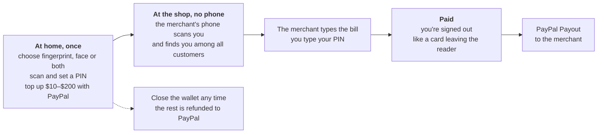
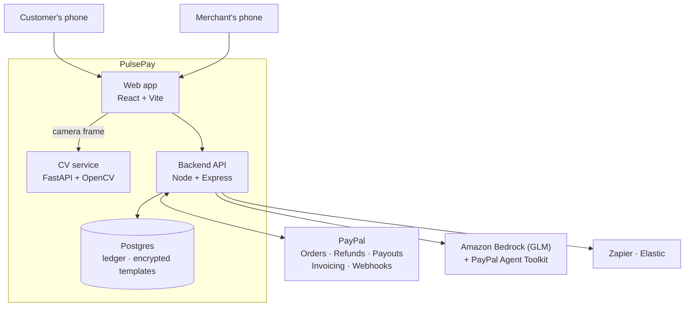

# PulsePay: leave your phone at home

**Pay at any shop with your fingerprint or face plus a PIN. Fund it with PayPal. The shop gets paid out to PayPal.**

Built for the [PayPal AI Hackathon](https://paypalaihackathon.devpost.com/).

Every way we pay in a shop today assumes the customer carries something: a card, a phone, a watch. PulsePay flips that. The shop already has a phone, so the customer brings only themselves. Your body plays the part of the card number, your PIN stays the PIN, and the money comes from a small prepaid wallet you topped up with PayPal.

<p align="center"><b>Scan → amount → PIN → paid → signed out.</b> No card, no phone, no QR code.</p>

---

## Try it in a minute

```bash
sh scripts/setup-env.sh     # writes .env with fresh random secrets
docker compose up --build   # the first build takes a few minutes
```

Open http://localhost:3000 and tap **Open my demo shop**. You get your own shop with this morning's sales already paid out, plus a demo customer holding $50:

1. **Checkout → Scan finger → Use the demo finger** (no camera needed). The terminal shows "Customer ••1234".
2. Enter a bill (say **$12**) and the **PIN** shown in the banner. Paid; the customer is signed out automatically.
3. **Dashboard:** the sale, the morning's PayPal payouts and the sales chart. **Assistant** (needs a Bedrock API key in `.env`): "How much did I take today?", "Anything unusual?", "Refund the last payment". Refunds work until the sale is cashed out.
4. **Cash out** on the Dashboard sends what the shop is owed to PayPal.
5. **User** tab: the same customer's wallet, now $38 ($50 if you refunded). **Wallet → Close wallet** refunds the rest to PayPal.

Prefer the real thing? Open the **User** tab on a laptop with a webcam, create a wallet (the camera stands in for a fingerprint scanner), then pay at the **Merchant** tab. Without PayPal keys everything runs on clearly labelled simulated PayPal; add sandbox keys to use real PayPal Checkout and Payouts ([setup](#paypal-sandbox)).

---

## How it works



1. **Open a wallet (once).** On your own phone, choose how shops should recognise you, scan, set a PIN and an emergency contact, and top up with **PayPal Checkout**. PulsePay captures the payment only after every check passes.
2. **Pay (no phone).** The merchant opens PulsePay in merchant mode. You scan; PulsePay identifies you among all customers and shows the merchant only "Customer ••1234". The merchant types the bill, you type your PIN on their phone, and the terminal signs you out like a card leaving the reader.
3. **The merchant gets paid** to their PayPal account with **PayPal Payouts** when they tap "Cash out" (or after every sale with `PAYOUT_MODE=instant`). Until then a sale can still be refunded. An **AI assistant** answers questions about their day and drafts refunds and invoices for them to confirm.
4. **Close it any time** from your phone; the balance is **refunded to the PayPal payments** that funded it.

**Distress finger:** if someone forces you to pay, use the finger you registered for that. The screens look identical, but at most $25 moves and your emergency contact gets a silent alert naming the shop.

The full walkthrough, with sequence diagrams, the ledger and every failure case, is in **[docs/HOW_IT_WORKS.md](docs/HOW_IT_WORKS.md)**.

---

## Why this could change how we pay

**The phone has become a single point of failure.** A dead battery, a phone left at home or in a gym locker, a stolen bag, a run or a day at the beach, and you can't buy a coffee. It also leaves out people who don't carry one at all: children, many older adults, people who can't afford a smartphone.

**PulsePay moves the hardware to the side that already has it.** Shops have phones. The customer needs nothing, and the shop needs no card reader or NFC terminal. In production that's a phone plus a low-cost fingerprint scanner.

**Risk is bounded by design instead of by trust.** Most biometric checkouts link your body to your whole card or bank account. PulsePay links it to a small prepaid wallet: at most $200, gone in 72 hours unless you extend it, a PIN on every payment, $100 per payment, three PIN tries, and a distress finger. If anything goes wrong, the most you can lose is what you put in, and you can close the wallet from your phone and get the rest back on PayPal.

**It runs on accounts people already have.** Customers fund it from PayPal; merchants are paid out to PayPal. Neither side needs a new bank relationship, a new card or new hardware from one vendor.

**You choose how you're recognised.** Fingerprint, face or both, independent of any phone maker. (A phone's Face ID can only confirm its owner; it can't identify a customer at someone else's counter.)

**Safety that cards can't offer.** A card can't tell a shop "I'm being forced". A distress finger can, quietly, while capping the loss.

**Small shops get a back office they can talk to.** "How much did I take today?", "Anything unusual?", "Invoice this customer." The assistant does the lookups and drafts the actions; a person confirms every money movement.

Where it fits first: places where carrying a phone or wallet is awkward or risky (gyms, pools, beaches, festivals, theme parks, campuses, hospitals, care homes) and families who want to give a child or an older parent a capped way to pay.

---

## PayPal in the pipeline

| PayPal capability | Where PulsePay uses it |
|---|---|
| **JavaScript SDK v6** (one-time payment session, PayPal button) | Wallet top-ups at sign-up and "Add money" ([`paypal-button.tsx`](frontend/src/app/components/paypal-button.tsx)) |
| **Orders v2** (create, capture, `PayPal-Request-Id`) | Server creates the order, captures it only after all checks pass, refunds it if the wallet can't be written ([`paypal.js`](backend/services/paypal.js), [`funding.js`](backend/services/funding.js)) |
| **Payments v2: refund a capture** | Closing a wallet refunds the balance to the captures that funded it, newest first |
| **Payouts v1** | Merchants cash out to their PayPal (or every sale is paid out, in instant mode); customers can send to any PayPal email ([`payouts.js`](backend/services/payouts.js)) |
| **Webhooks** + signature verification | Payout status, disputes (a disputed top-up freezes its wallet), paid invoices ([`routes/paypal.js`](backend/routes/paypal.js)) |
| **Invoicing via the PayPal Agent Toolkit** | The AI assistant creates and sends invoices and QR codes; paid invoices are credited to the merchant and paid out ([`assistant.js`](backend/services/assistant.js)) |
| **Developer sandbox** | Sandbox app credentials, a buyer account for top-ups, a business account for payouts |

Every money-moving call is idempotent: retries after a timeout reuse the same `PayPal-Request-Id` (or `sender_batch_id`), so nothing is captured, refunded or paid out twice.

## Partner tools

| Tool | How PulsePay uses it |
|---|---|
| **Amazon Bedrock** | GLM powers the merchant assistant ([`bedrock.js`](backend/services/bedrock.js)); falls back from GLM 5.3 to GLM 5 automatically |
| **AG Grid** (AG Grid + AG Charts) | Merchant dashboard: payments grid with refunds, payouts grid with PayPal status, sales-by-hour chart ([`merchant-dashboard.tsx`](frontend/src/app/components/merchant-dashboard.tsx)) |
| **Postman** | The demo as a runnable collection with chained tokens: sign-ups, a PayPal-funded wallet, a payment, cash-out, a refused late refund, closing the wallet ([`postman/`](postman/)) |
| **Render** | [`render.yaml`](render.yaml) deploys the whole demo as one web service plus Postgres; gives PayPal webhooks a public URL |
| **Zapier** | SOS alerts, receipts, payout failures and disputes are posted to a Zapier Catch Hook so a Zap can text or email without code |
| **Elastic** | Optional activity index; the assistant gets a search tool when configured ([`elastic.js`](backend/services/elastic.js)) |

---

## Architecture



Locally the web app, API and CV service run as separate containers. The hosted demo packs them into one container ([`Dockerfile`](Dockerfile)): the API serves the web app and forwards camera frames to the CV service, so there is one URL and the CV service is never exposed.

Money is kept in a balanced double-entry ledger. A top-up debits PulsePay's PayPal pool and credits the customer's wallet; a sale moves that to what PulsePay owes the merchant; a successful payout settles it. The tests check that every entry balances and that the pool always equals what PulsePay owes. Details: [docs/HOW_IT_WORKS.md](docs/HOW_IT_WORKS.md#where-the-money-is-the-ledger).

## Security and privacy

- **Two factors on every shop payment:** the customer's chosen biometric(s) and their PIN. Three wrong PINs lock it for 30 minutes.
- **Templates can't be reused elsewhere:** vectors are scrambled with a per-record secret and encrypted (AES-256-GCM); a leaked template is useless in another database and can be re-issued.
- **No guessing:** a 1:N match must clearly beat the runner-up, or the scan is retaken. Duplicate identities are refused at sign-up.
- **Separate token types** for customers, merchants, sign-up and pay sessions; a pay session is single-use and lasts 2 minutes.
- **The assistant only proposes** refunds and cash-outs; a person confirms. It sees customers masked and never sees distress data.
- **PayPal secrets stay on the server**; webhooks are acted on only after PayPal verifies them.
- **Demo shortcuts are fenced off:** showing codes in the app and the one-tap demo are refused whenever PayPal is live.

## Honest limits

- A webcam can't read fingerprint ridges. A real deployment needs a certified fingerprint scanner and face model with liveness detection; the camera and OpenCV stand-ins here are for the demo, and their error rates are unmeasured.
- SMS is mocked (codes appear in the app in demo mode).
- PayPal runs in sandbox. Holding customer balances and using Payouts at scale needs PayPal's approval, and biometric payments need consent and privacy compliance in each market.

The full status, including what was verified and how, is in [MVP_SCOPE.md](MVP_SCOPE.md).

---

## Run it

### PayPal sandbox

1. At https://developer.paypal.com/dashboard/ go to **Apps & Credentials** (Sandbox) and **Create App**. Make sure **Payouts** is enabled for the app.
2. Put the **Client ID** and **Secret** in `.env` as `PAYPAL_CLIENT_ID` and `PAYPAL_CLIENT_SECRET`.
3. In **Testing Tools → Sandbox Accounts**, use the Personal account to approve top-ups, and register a merchant with a Business account's email to see payouts arrive.

### Start

```bash
cp .env.example .env
docker compose up --build
```

Frontend http://localhost:3000 · Backend http://localhost:5000 · CV service http://localhost:8000. The backend upgrades an existing database on start (`backend/scripts/migrate.js`).

### Tests

```bash
docker compose --profile test up -d postgres-test   # throwaway Postgres on 127.0.0.1:5434
cd backend && npm run test:db
```

126 tests: the ledger, biometric matching, the merchant terminal over HTTP (scan, PIN, lockout, distress, "both" mode), payouts, top-ups, refunds, webhooks, the AI assistant (against a local Bedrock stand-in), the demo mode, database upgrades and the one-URL hosting. The PayPal tests run the real client against [a local stand-in for the PayPal API](backend/test/support/fake-paypal.js) that follows PayPal's documented behaviour, including lost responses and duplicate requests. Every test was checked by breaking the code it protects and confirming it fails. `npm test` alone runs the tests that need no database.

The Postman collection runs the demo flow against a running server (15 requests, 19 checks):

```bash
npx newman run postman/PulsePay.postman_collection.json --env-var baseUrl=http://localhost:5000
```

### Deploy (one URL on Render)

[`render.yaml`](render.yaml) is a Render Blueprint: one web service built from the root [`Dockerfile`](Dockerfile) (API, web app and CV service in one container) plus Postgres, with the demo shortcuts on and PayPal in sandbox.

1. Render dashboard → **New → Blueprint** → pick this repository.
2. When asked, paste `PAYPAL_CLIENT_ID` and `PAYPAL_CLIENT_SECRET` (sandbox) and `AWS_BEARER_TOKEN_BEDROCK`. Render generates the other secrets, and the database schema is applied on start.
3. Open `https://<service>.onrender.com` and tap **Open my demo shop**.
4. Optional: create a PayPal webhook for `https://<service>.onrender.com/api/paypal/webhook` (events `PAYMENT.PAYOUTS-ITEM.*`, `CUSTOMER.DISPUTE.CREATED`, `INVOICING.INVOICE.PAID`) and add `PAYPAL_WEBHOOK_ID` to the service.

The blueprint uses free plans: the service sleeps after 15 idle minutes (the next visit takes about a minute) and a free database expires 30 days after creation. To keep the demo up through judging (Dec 1–15, 2026), move the database to a paid plan, and the service too if the wake-up wait matters.

The same container runs locally: `docker build -t pulsepay .` then `docker run -p 10000:10000 --env-file .env -e DATABASE_URL=<postgres url> pulsepay` and open http://localhost:10000.

## Repository map

| Path | What's there |
|---|---|
| `frontend/` | React app: User mode (wallet) and Merchant mode (terminal, dashboard, assistant) |
| `backend/` | Express API: `routes/`, `services/` (ledger, payments, payouts, PayPal, biometrics, assistant), `test/` |
| `cv-service/` | FastAPI + OpenCV: camera frame to vector |
| `database/schema.sql` | Postgres schema |
| `docs/HOW_IT_WORKS.md` | Detailed walkthrough with diagrams |
| `openapi.yaml`, `postman/` | OpenAPI 3.1 spec and runnable Postman collection |
| `Dockerfile`, `render.yaml` | The hosted demo: one container, one Render Blueprint |
| `docs/archive/` | The original design from an earlier hackathon (India/UPI), kept for history |

## License

[MIT](LICENSE)
