<div align="center">

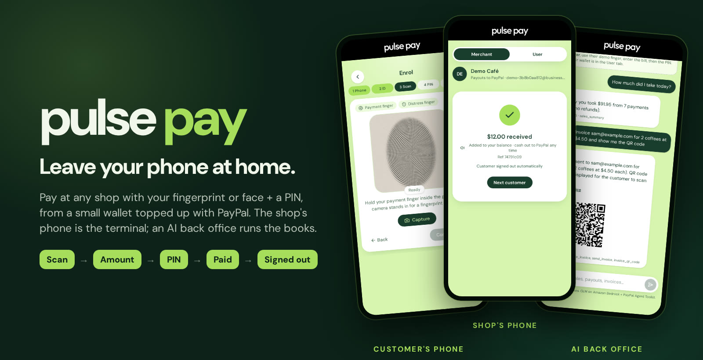

# PulsePay

### Leave your phone at home.

Pay at any shop with your **fingerprint or face + a PIN**, from a small wallet you top up with **PayPal**.<br>
The shop's own phone is the terminal. An **AI back office** keeps the books.

[](#-paypal-end-to-end)
[](#-the-ai-back-office)<br>
[](#-how-we-know-it-works)
[](postman/)
[](frontend/src/app/components/merchant-dashboard.tsx)
[](LICENSE)

**[Try it in 3 minutes](#-try-it-in-3-minutes)** · **[How it works](#-how-it-works)** · **[Deep dive](docs/HOW_IT_WORKS.md)**

<sub>Built for the <a href="https://paypalaihackathon.devpost.com/">PayPal AI Hackathon</a> 2026</sub>

</div>

---

## 💡 The idea

Every way we pay in a shop assumes the customer **carries something**: a card, a phone, a watch.

- 🔋 A dead battery, and you can't buy a coffee.
- 🔒 Your phone is in a gym locker, a pool bag or a hotel safe.
- 🧒 Kids, many older adults and people without a smartphone are left out completely.

**The shop already has a phone. So PulsePay lets the customer bring only themselves.**

| 1. Scan | 2. Amount | 3. PIN | 4. Paid | 5. Signed out |
|:---:|:---:|:---:|:---:|:---:|
| The shop's phone recognises you among every customer | The merchant types the bill | You type your PIN | Money moves inside a capped wallet | The terminal forgets you, like a card leaving the reader |

Your body plays the part of the card number, your PIN stays the PIN, and the money comes from a **small prepaid wallet you funded with PayPal**. Neither factor is useful on its own, and the most anyone can ever lose is what you put in.

---

## 🎬 See it work

<table>
<tr>
<td width="34%" align="center" valign="top">
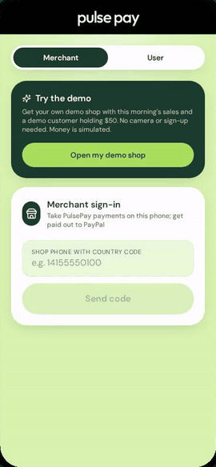<br>
<sub><b>A real payment.</b> Identify → $12 → PIN → paid → signed out.</sub>
</td>
<td valign="top">

**What happens in that GIF**

1. The merchant taps **Scan finger**. PulsePay compares the scan with every customer (1:N) and shows only **"Customer ••4305"**: no name, no phone number, no balance.
2. A **2-minute pay session** opens. The merchant enters **$12**.
3. The customer types their **PIN** on the merchant's phone.
4. One database transaction checks the PIN, uses up the session, debits the wallet and records what PulsePay owes the shop.
5. The terminal says the amount out loud and **signs the customer out**.

The 2½-minute demo video walks through everything: opening a wallet with the PayPal popup, paying, the dashboard, and the AI assistant creating a **real PayPal sandbox invoice**.

</td>
</tr>
</table>

<details>
<summary><b>📸 Every screen</b> (click to open)</summary>
<br>

| Open a wallet (customer's phone) | | | |
|:---:|:---:|:---:|:---:|
| 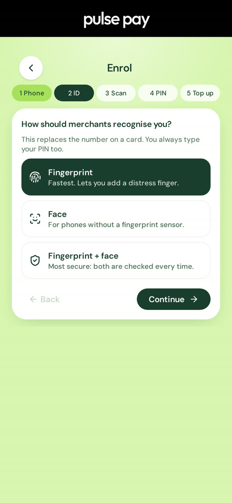 | 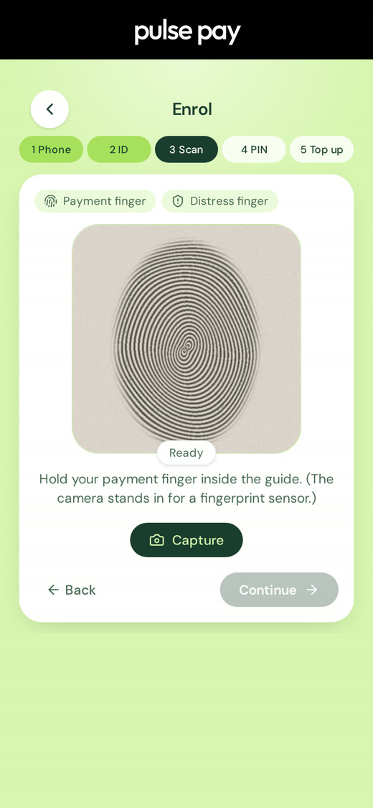 | 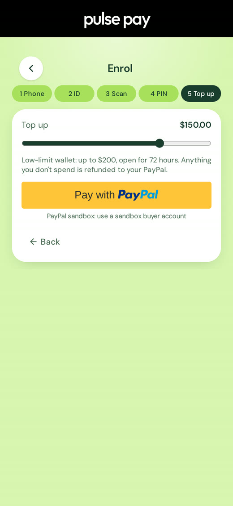 | 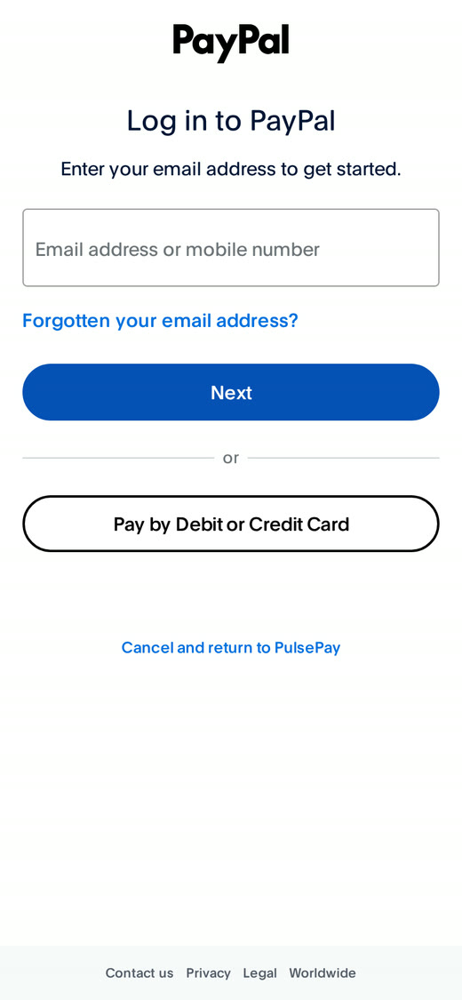 |
| Choose fingerprint, face or both | Scan (the webcam stands in for a sensor) | Top up $10–$200 with the PayPal button (JS SDK v6) | Real PayPal sandbox checkout |

| Pay at the shop (merchant's phone) | | | |
|:---:|:---:|:---:|:---:|
| 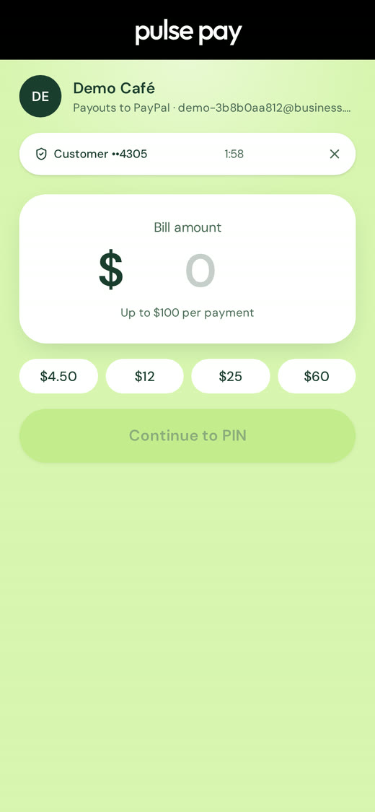 | 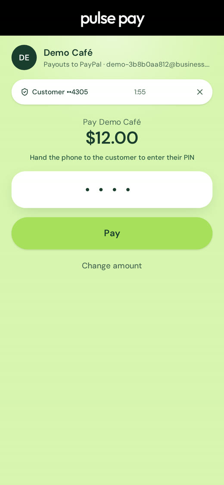 | 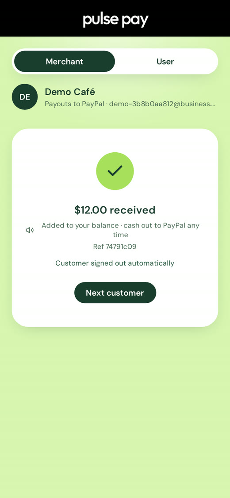 | 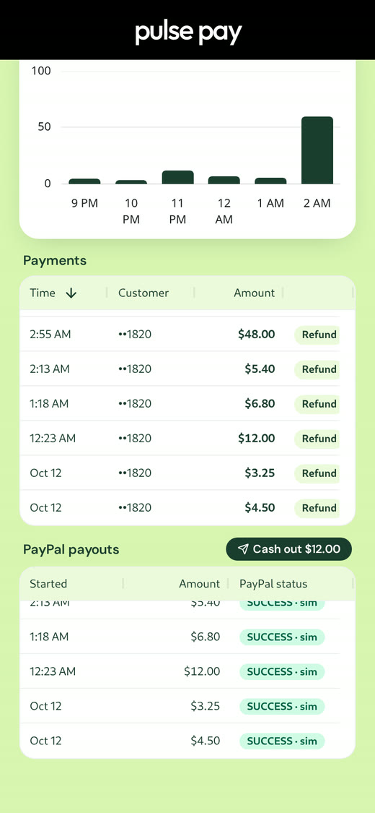 |
| Identified, masked, 2-minute session | Customer types their PIN | Paid, customer signed out | AG Grid payments & PayPal payouts |

| The shop's back office | | | Back home |
|:---:|:---:|:---:|:---:|
| 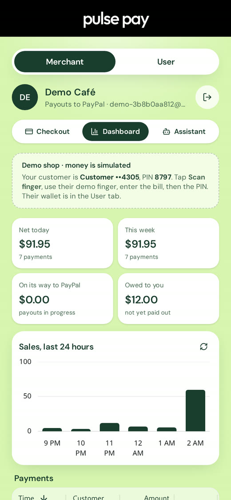 | 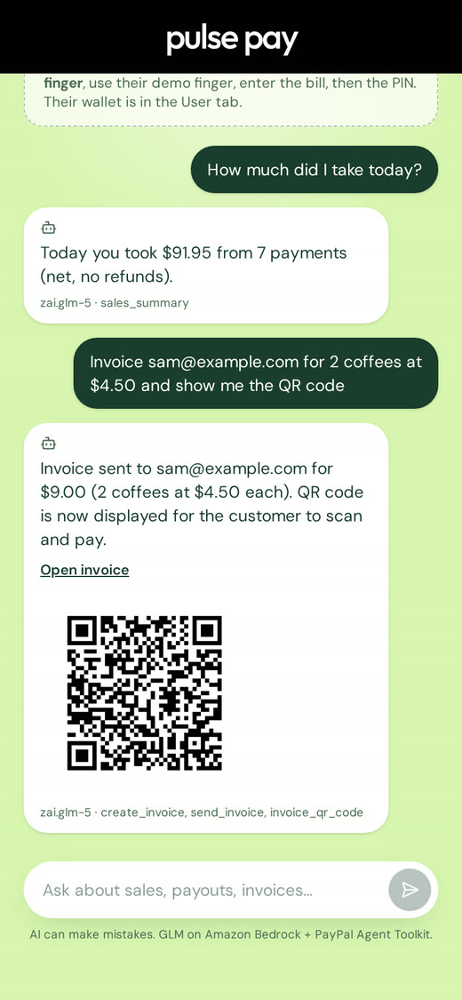 | 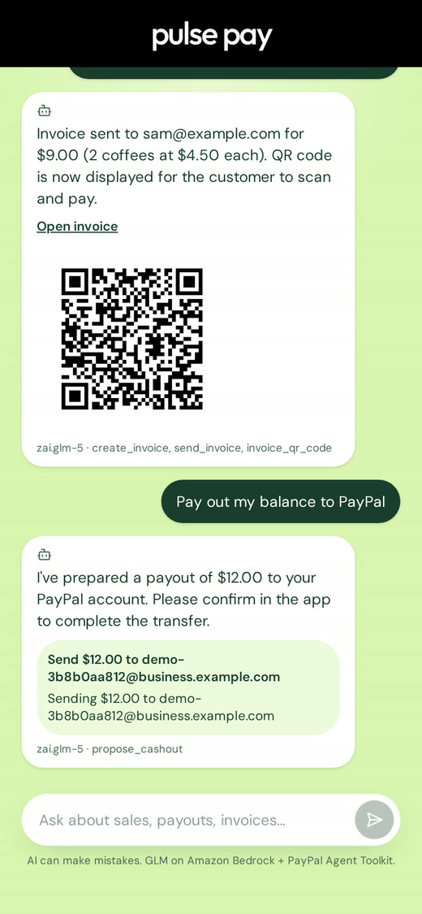 | 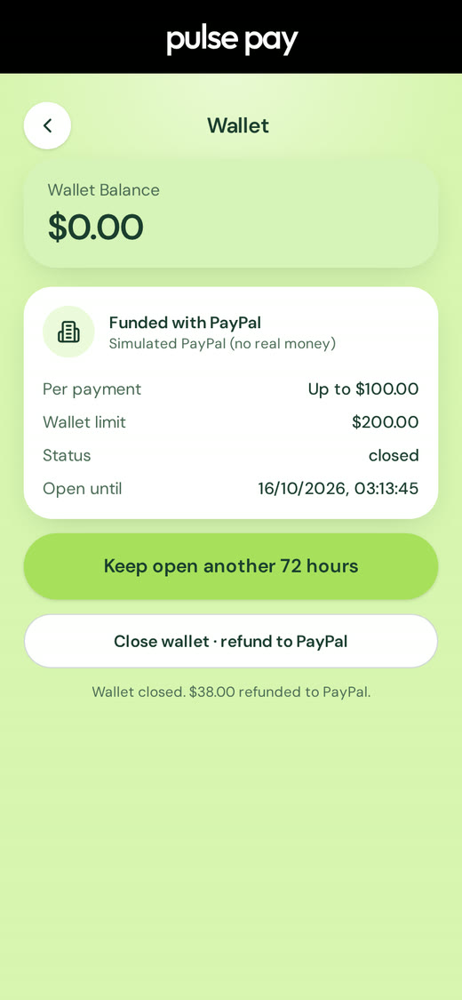 |
| Today's takings, what's owed, sales by hour (AG Charts) | AI assistant: real PayPal invoice + QR code | Cash-out proposed; a person confirms | Close the wallet; the rest goes back to PayPal |

</details>

---

## 🚀 Try it in 3 minutes

You need Docker (or Podman) and a browser. No accounts, no keys.

```bash
git clone https://github.com/Ritesh-Root/pulsepay-paypal.git && cd pulsepay-paypal
sh scripts/setup-env.sh     # writes .env with fresh random secrets
docker compose up --build   # the first build takes a few minutes
```

Open **http://localhost:3000** and tap **Open my demo shop**. You get your own shop with this morning's sales, plus a demo customer holding $50 (money in demo shops is simulated):

1. **Checkout → Scan finger → Use the demo finger** (no camera needed). The terminal shows "Customer ••1234".
2. Pick a bill (say **$12**) and type the **PIN** shown in the green banner. Paid, and the customer is signed out.
3. **Dashboard:** the sale, the morning's payouts and the sales chart.
4. **Assistant** (needs a Bedrock key, see below): "How much did I take today?", "Anything unusual?", "Refund the last payment". Refunds work until the sale is cashed out.
5. **Cash out** on the Dashboard sends what the shop is owed to PayPal.
6. **User** tab: the same customer's wallet, now $38. **Wallet → Close wallet** refunds the rest.

Want the full journey? On a laptop with a webcam, open **User → Profile → Create wallet** and enrol yourself, then pay at the **Merchant** tab.

<details>
<summary><b>🔑 Turn on real PayPal and the AI assistant</b></summary>
<br>

Without keys, PayPal runs in a clearly labelled **simulated** mode and the assistant is off. Add keys to `.env` and restart:

**PayPal sandbox** (free):
1. https://developer.paypal.com/dashboard/ → **Apps & Credentials** (Sandbox) → **Create App** (type Merchant). Tick **Payouts** and **Invoicing** under Features.
2. Put the **Client ID** and **Secret** in `.env` as `PAYPAL_CLIENT_ID` and `PAYPAL_CLIENT_SECRET`.
3. **Testing Tools → Sandbox Accounts**: log in to the PayPal popup with the **Personal** account; register a shop with a **Business** account's email to see payouts arrive.

PayPal blocks Payouts from sandbox accounts based in some countries (for example India: "You live in a country that is not allowed to send this payout"). Link the app to a **US business** sandbox account to use payouts.

**Amazon Bedrock** (for the assistant): create a Bedrock API key in the AWS console (region `us-east-1`, with access to the Z.ai GLM models) and set `AWS_BEARER_TOKEN_BEDROCK`.

</details>

---

## 🧭 How it works

### The journey

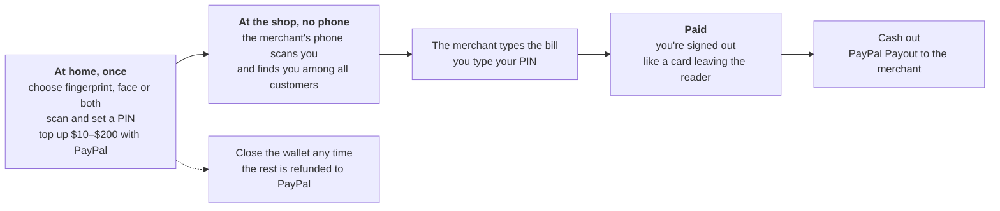

1. **Open a wallet (once).** On your own phone, choose how shops should recognise you, scan, set a PIN and an emergency contact, and top up with **PayPal Checkout**. PulsePay captures the payment only **after** every other check passes; if the wallet can't be written, the capture is refunded.
2. **Pay (no phone).** The shop's phone identifies you 1:N, the merchant types the bill, you type your PIN, the terminal signs you out.
3. **The merchant gets paid** with **PayPal Payouts** when they tap **Cash out** (or after every sale with `PAYOUT_MODE=instant`). Until then a sale can still be refunded to the customer's wallet.
4. **Close it any time.** The balance is refunded to the PayPal payments that funded it, newest first.

### What's inside

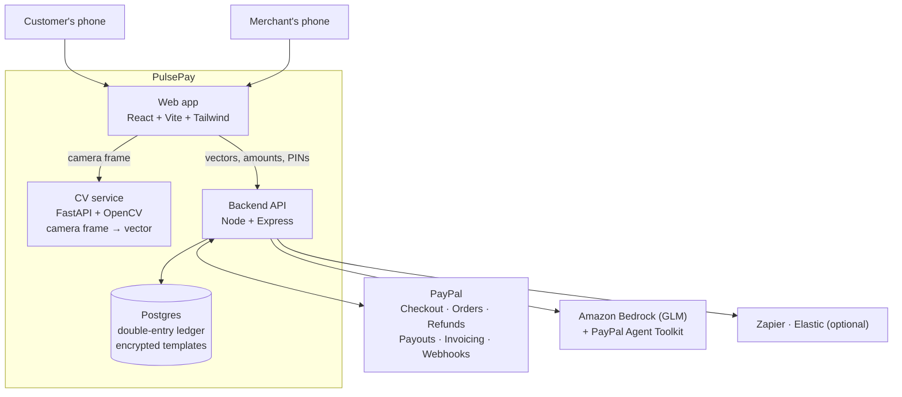

| Piece | Job |
|---|---|
| **Web app** (`frontend/`) | One app, two modes: **User** (the customer's phone: open, top up, send, close) and **Merchant** (terminal, dashboard, assistant). |
| **CV service** (`cv-service/`) | Turns a camera frame into a 1,024-number vector. No image is stored. |
| **Backend** (`backend/`) | Identification, pay sessions, PINs, the ledger, every PayPal call, payouts, webhooks and the assistant. |
| **Postgres** (`database/schema.sql`) | Ledger, wallets, encrypted templates, pay sessions, payouts, audit log. |

Locally these run as separate containers. The hosted demo packs them into **one container** ([`Dockerfile`](Dockerfile)): the API serves the web app and forwards camera frames to the CV service, so there is one URL and the CV service is never exposed.

<details>
<summary><b>🔁 A payment, call by call</b></summary>

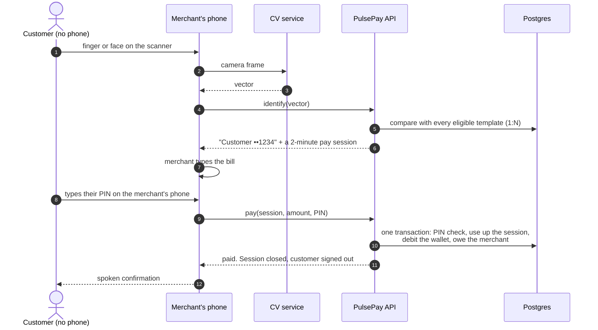

The session is used up **inside the same transaction** as the debit, so a payment can't happen twice, even under retries: a replay returns the first receipt.

</details>

<details>
<summary><b>🧾 Where the money is: a double-entry ledger</b></summary>

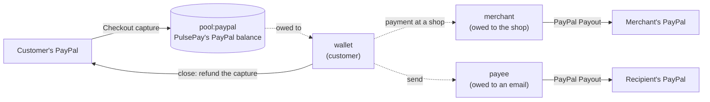

| Event | Debit | Credit |
|---|---|---|
| Top-up captured | `pool:paypal` | `wallet:<id>` |
| Payment at a shop | `wallet:<id>` | `merchant:<id>` |
| Send to a PayPal email | `wallet:<id>` | `payee:<email>` |
| Payout succeeded | `merchant:<id>` or `payee:<email>` | `pool:paypal` |
| Merchant refunds a payment | `merchant:<id>` | `wallet:<id>` |
| Paid PayPal invoice | `pool:paypal` | `merchant:<id>` |
| Wallet closed | `wallet:<id>` | `pool:paypal` |

The tests check two invariants after every scenario: every group balances, and the PayPal pool always equals what PulsePay owes (wallets + merchants + payees).

</details>

<details>
<summary><b>💸 A payout's life</b></summary>

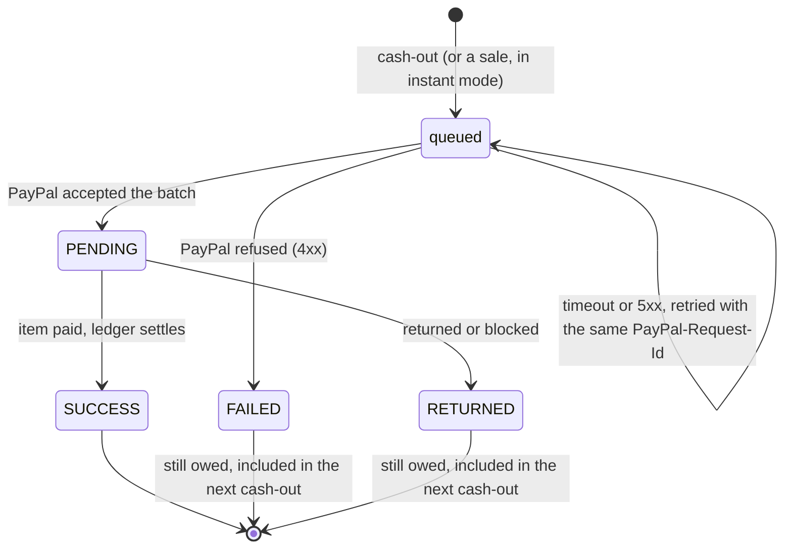

The shop's balance only goes down when PayPal reports the payout **item** as `SUCCESS` (by verified webhook, or a background poll when there's no public URL). Refunds and payouts lock the same merchant row, so they can never both spend one balance, and a payout can never exceed what is owed.

</details>

<details>
<summary><b>🫆 How a person is recognised</b></summary>

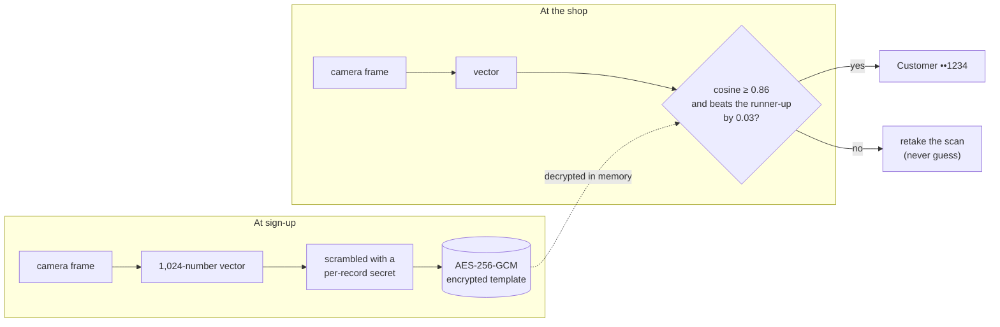

- **Cancelable templates:** the per-record scramble (permutation + sign flips) keeps similarity intact, so a stolen template can't be matched against any other database, and it can be re-issued.
- **No duplicates:** sign-up refuses a scan that already matches someone else, and a distress finger that looks too much like the payment finger.
- **Fingerprint, face or both:** with "both", the first scan finds the person and the second must match that same person 1:1. A phone's own Face ID can't do this; it only answers "is this the phone's owner?"

</details>

---

## 💳 PayPal, end to end

| PayPal capability | Where PulsePay uses it |
|---|---|
| **JavaScript SDK v6** (PayPal button, one-time payment session) | Wallet top-ups at sign-up and "Add money" ([`paypal-button.tsx`](frontend/src/app/components/paypal-button.tsx)) |
| **Orders v2** (create, capture, `PayPal-Request-Id`) | The server creates the order and captures it **only after all checks pass** ([`paypal.js`](backend/services/paypal.js), [`funding.js`](backend/services/funding.js)) |
| **Payments v2: refund a capture** | Closing a wallet refunds the balance to the captures that funded it, newest first; a capture that can't be credited is refunded |
| **Payouts** | Merchant cash-out (or every sale, in instant mode) and "send to any PayPal email" ([`payouts.js`](backend/services/payouts.js)) |
| **Webhooks** + signature verification | Payout status, disputes (a disputed top-up freezes its wallet), paid invoices ([`routes/paypal.js`](backend/routes/paypal.js)) |
| **Invoicing via the PayPal Agent Toolkit** | The AI assistant creates, sends and tracks invoices and QR codes ([`assistant.js`](backend/services/assistant.js)) |

**Nothing moves twice.** Every money call is idempotent, and the hard cases are handled explicitly:

| When this happens… | …PulsePay does this |
|---|---|
| Two requests try to capture one order | The order is claimed atomically; one capture. |
| The buyer's funding source is declined | The next attempt uses a **new** `PayPal-Request-Id` (a reused one would replay the decline). |
| PayPal captured but the response was lost | The retry sends the **same** `PayPal-Request-Id` and gets the original capture back; if the buyer never returns, a sweep refunds it after 10 minutes. |
| A payout's response was lost | The retry reuses the batch id as `PayPal-Request-Id`; the shop is paid once. |
| PayPal is down (5xx) | The payout stays queued; a background job retries it. |
| A webhook arrives unverified, or twice | Stored, acted on once when it verifies; duplicates are ignored. |
| A refund is asked for after cash-out | Refused: the money is already in the shop's PayPal, so the shop refunds from PayPal. |

Checked against the **live PayPal sandbox**: OAuth, order creation, the SDK v6 button and checkout popup, refusing to capture an unapproved order, and invoice create, send, status and QR code through the Agent Toolkit. That live run caught a real bug: the toolkit returns its JSON **encoded twice**, so invoice status was never read. It's fixed and covered by tests.

---

## 🤖 The AI back office

Small shops get a back office they can **talk to**, running **GLM on Amazon Bedrock** (Converse API with tool use) plus the **PayPal Agent Toolkit**:

> **"How much did I take today?"**<br>
> *You took $91.95 today from 7 payments, with no refunds. Your largest payment was $48.00 and the average was $13.14.*
>
> **"Invoice sam@example.com for 2 coffees at $4.50 and show me the QR code"**<br>
> *Invoice INV2-2T6F-… sent to sam@example.com for $9.00. The QR code is now displayed for the customer to scan and pay.*
>
> **"Pay out my balance to PayPal"**<br>
> *I've prepared a payout of $12.00 to your PayPal account.* → **[Confirm]**

| The model can… | Tools |
|---|---|
| **Look things up** | `sales_summary`, `recent_payments`, `payout_status`, `anomaly_report`, `search_activity` (when Elastic is set up) |
| **Propose, never perform** | `propose_refund`, `propose_cashout`: they come back as a card with a **Confirm** button that a person taps |
| **Use PayPal** | `create_invoice`, `send_invoice`, `invoice_status`, `invoice_qr_code` via the Agent Toolkit, only on that shop's invoices |

**Guardrails:** customers appear only masked; the distress flag is never visible to the model; tool results are data, never instructions; at most 6 tool steps per answer; demo shops get 10 questions each. A paid invoice is credited to the shop only when PayPal actually collected it (`PAID`), never one marked paid by hand.

---

## 🛡️ Safety by design

Most biometric checkouts link your body to your whole card or bank account. PulsePay links it to a **small, short-lived wallet**:

| Limit | Value | Why |
|---|---|---|
| Wallet balance | $200 max · $10 min top-up | A lost or coerced "body card" can't empty a bank account |
| Wallet lifetime | 72 hours, extendable to 7 days | The risk window closes by itself |
| Per payment | $100 | Counter purchases, not transfers |
| PIN | Every payment · 3 tries, then locked 30 minutes | A merchant's device can't be used to guess PINs |
| Pay session | 2 minutes, one payment | Nothing lingers on the merchant's phone |
| One-time codes | 5 guesses per code, 3 codes per 10 minutes | Codes can't be brute-forced |
| **Distress finger** | at most **$25** moves + a **silent alert** to your emergency contact | A card can't tell a shop "I'm being forced"; this can, quietly |

- **Two factors on every shop payment:** the biometric says who you are, the PIN proves you chose to pay.
- **Separate token types** for customers, merchants, sign-up and pay sessions; each opens only its own routes.
- **Secrets stay on the server**; the server refuses to start without its encryption and signing keys (fail closed).
- **Demo shortcuts are fenced off:** showing codes in the app and the one-tap demo are refused whenever PayPal is live.

---

## 🌍 Why this could change how we pay

- **The phone stops being a single point of failure.** Dead battery, phone at home, stolen bag, a run or a beach day: you can still pay.
- **The hardware moves to the side that already has it.** Shops have phones. No card reader or NFC terminal is needed; in production, a phone plus a low-cost fingerprint scanner.
- **Risk is bounded by design instead of by trust.** If anything goes wrong, the most you can lose is what you put in, and you can close the wallet from your phone.
- **It runs on accounts people already have.** Customers fund with PayPal; merchants are paid out to PayPal. No new bank relationship, card or vendor-locked hardware.
- **You choose how you're recognised:** fingerprint, face or both, independent of any phone maker.
- **Small shops get a back office they can talk to**, with a person confirming every money movement.

**Where it fits first:** gyms, pools, beaches, festivals, theme parks, campuses, hospitals and care homes, and families giving a child or an older parent a capped way to pay.

---

## ✅ How we know it works

| Check | Result |
|---|---|
| **Automated tests** | **137 passing** against a real Postgres: ledger, biometric matching, the terminal over HTTP (scan, PIN, lockout, distress, "both"), payouts, top-ups, refunds, webhooks, the assistant, demo mode, database upgrades and hosting |
| **PayPal stand-in** | The PayPal tests drive the real client against [a local PayPal API stand-in](backend/test/support/fake-paypal.js) that reproduces lost responses, duplicate requests, declines and 5xx |
| **Mutation-checked** | Each test was verified by breaking the code it protects and confirming it fails |
| **Postman** | [The demo as a collection](postman/): 15 requests, 19 checks, including cash-out and a refused late refund |
| **Live sandbox** | PayPal OAuth, orders, SDK v6 checkout popup and invoicing via the Agent Toolkit; GLM on Bedrock answering live |
| **Fresh clone** | The README steps were run from an empty folder on a clean checkout |
| **Hosted build** | The one-container image ran the whole demo at Render free-plan limits (0.1 CPU, 512 MB) |

```bash
docker compose --profile test up -d postgres-test   # throwaway Postgres on 127.0.0.1:5434
cd backend && npm run test:db                       # all 137 tests
npx newman run postman/PulsePay.postman_collection.json --env-var baseUrl=http://localhost:5000
```

---

## 🧩 Partner tools

| Tool | How PulsePay uses it |
|---|---|
| **Amazon Bedrock** | GLM runs the merchant assistant; falls back from GLM 5.3 to GLM 5 automatically ([`bedrock.js`](backend/services/bedrock.js)) |
| **AG Grid** (+ AG Charts) | The merchant dashboard: payments with refunds, payouts with live PayPal status, sales by hour, fitted to a phone screen ([`merchant-dashboard.tsx`](frontend/src/app/components/merchant-dashboard.tsx)) |
| **Postman** | The whole demo as a runnable collection with chained tokens ([`postman/`](postman/)) |
| **Render** | [`render.yaml`](render.yaml): the whole demo as one web service plus Postgres; gives PayPal webhooks a public URL |
| **Zapier** (optional) | SOS alerts, receipts, payout failures and disputes go to a Zapier Catch Hook |
| **Elastic** (optional) | Activity index; the assistant gets a search tool ([`elastic.js`](backend/services/elastic.js)) |

---

## ☁️ Deploy (one URL on Render)

[`render.yaml`](render.yaml) is a Render Blueprint: one web service built from the root [`Dockerfile`](Dockerfile) (API, web app and CV service in one container) plus Postgres, with the demo shortcuts on and PayPal in sandbox.

1. Render dashboard → **New → Blueprint** → pick this repository.
2. Paste `PAYPAL_CLIENT_ID`, `PAYPAL_CLIENT_SECRET` and `AWS_BEARER_TOKEN_BEDROCK` when asked. Render generates the other secrets; the schema is applied on start.
3. Open `https://<service>.onrender.com` and tap **Open my demo shop**.
4. Optional: a PayPal webhook for `https://<service>.onrender.com/api/paypal/webhook` (events `PAYMENT.PAYOUTS-ITEM.*`, `CUSTOMER.DISPUTE.CREATED`, `INVOICING.INVOICE.PAID`), then add `PAYPAL_WEBHOOK_ID`.

Free plans sleep after 15 idle minutes, and a free database expires 30 days after creation. The same container runs anywhere: `docker build -t pulsepay .` then `docker run -p 10000:10000 --env-file .env -e DATABASE_URL=<postgres url> pulsepay`.

<details>
<summary><b>⚙️ Configuration reference</b></summary>
<br>

| Variable | Default | What it does |
|---|---|---|
| `JWT_SECRET`, `KMS_DATA_KEY` | required | Token signing; template encryption key (32 bytes as hex or base64). The server won't start without them. |
| `PAYPAL_CLIENT_ID`, `PAYPAL_CLIENT_SECRET` | empty → simulated | PayPal REST app credentials |
| `PAYPAL_ENVIRONMENT` | `sandbox` | `live` moves real money (and turns the demo shortcuts off) |
| `PAYPAL_WEBHOOK_ID` | empty | Enables verified webhooks |
| `PAYOUT_MODE` | `manual` | `manual`: merchants tap Cash out. `instant`: a payout after every sale |
| `AWS_BEARER_TOKEN_BEDROCK` | empty → assistant off | Bedrock API key |
| `BEDROCK_MODEL_ID` / `BEDROCK_FALLBACK_MODEL_ID` | `zai.glm-5.3` / `zai.glm-5` | Assistant model and fallback |
| `DEMO_MODE`, `DEMO_SHOW_OTP` | `true` in `.env.example` | One-tap demo shops; codes shown in the app |
| `MAX_BALANCE_CENTS`, `PER_PAYMENT_LIMIT_CENTS`, `DISTRESS_CAP_CENTS` | 20000, 10000, 2500 | Wallet, payment and distress caps |
| `BIOMETRIC_MATCH_THRESHOLD` | 0.86 | Minimum cosine similarity for a match |
| `TRUST_PROXY` | empty | Set to `1` behind one proxy (Render) so rate limits see the visitor |
| `ZAPIER_WEBHOOK_URL`, `ELASTIC_URL`, `ELASTIC_API_KEY` | empty | Optional integrations |

</details>

---

## 🗂️ Repository map

| Path | What's there |
|---|---|
| [`frontend/`](frontend/) | React app: User mode (wallet) and Merchant mode (terminal, dashboard, assistant) |
| [`backend/`](backend/) | Express API: `routes/`, `services/` (ledger, payments, payouts, PayPal, biometrics, assistant), `test/` (137 tests) |
| [`cv-service/`](cv-service/) | FastAPI + OpenCV: camera frame → vector |
| [`database/schema.sql`](database/schema.sql) | Postgres schema |
| [`docs/HOW_IT_WORKS.md`](docs/HOW_IT_WORKS.md) | The deep dive: every flow, failure case and limit |
| [`docs/DEMO_SCRIPT.md`](docs/DEMO_SCRIPT.md) | The demo video script |
| [`openapi.yaml`](openapi.yaml), [`postman/`](postman/) | OpenAPI 3.1 spec and runnable Postman collection |
| [`Dockerfile`](Dockerfile), [`render.yaml`](render.yaml) | The hosted demo: one container, one Render Blueprint |
| [`MVP_SCOPE.md`](MVP_SCOPE.md) | What is implemented, what was verified live, what is simulated |
| [`docs/archive/`](docs/archive/) | The original design from an earlier India/UPI prototype, kept for history |

---

## ⚖️ Honest limits

- **Biometrics are stand-ins.** A webcam can't read fingerprint ridges. A real deployment needs a certified fingerprint scanner and a face model with liveness detection; error rates here are unmeasured.
- **SMS is mocked**; in demo mode the one-time code appears in the app.
- **PayPal runs in sandbox.** Live sandbox payouts need a US-based sandbox business account (PayPal refuses payouts from some countries, including India). Holding customer balances and using Payouts at scale would need PayPal's approval, and biometric payments need consent and privacy compliance in each market.
- **Demo shops use simulated money**, clearly labelled, so anyone can try the full flow without a PayPal login.

The full status matrix is in [MVP_SCOPE.md](MVP_SCOPE.md).

## 🛣️ What's next

- Certified fingerprint hardware and a liveness-checked face model.
- Pilots where carrying a phone is awkward: gyms, pools, festivals, campuses, care homes.
- Family wallets with per-person caps (the API is in place).
- A merchant-side PayPal onboarding flow, so shops cash out to an account they connect themselves.

## 📜 License

[MIT](LICENSE) © 2026 Ritesh-Root
