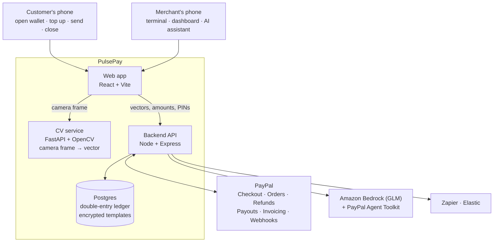
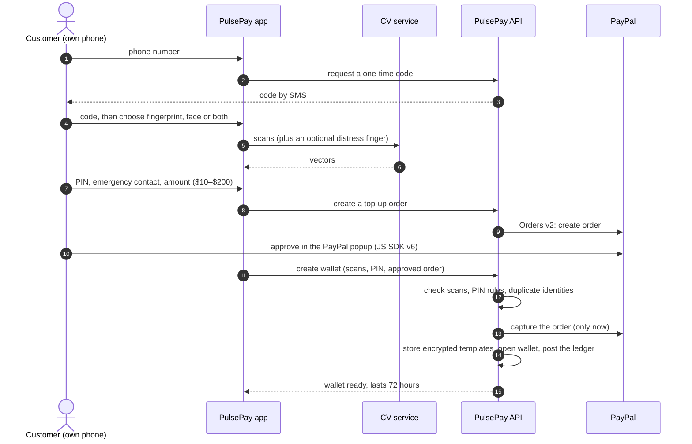
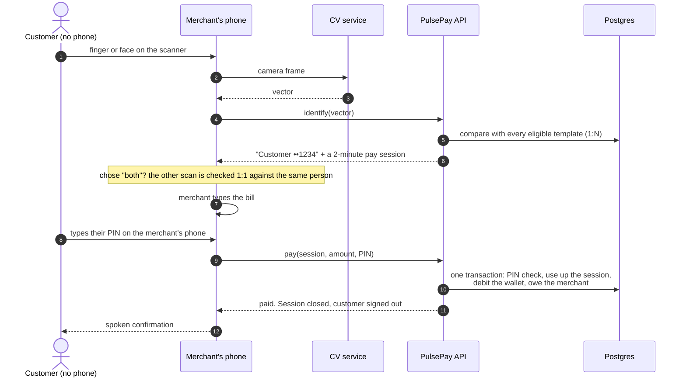
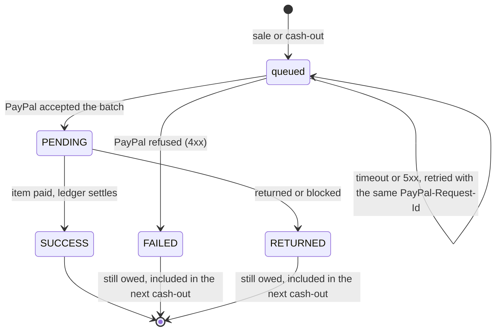
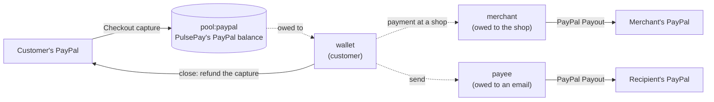

# How PulsePay works

This is the detailed walkthrough: who does what, where the money sits at each step, and what happens when something fails. The short version is in the [README](../README.md).

- [The two moments](#the-two-moments)
- [The pieces](#the-pieces)
- [1. Opening a wallet (at home, once)](#1-opening-a-wallet-at-home-once)
- [2. Paying at a shop (no phone)](#2-paying-at-a-shop-no-phone)
- [3. Getting the merchant paid](#3-getting-the-merchant-paid)
- [4. Closing the wallet](#4-closing-the-wallet)
- [Where the money is: the ledger](#where-the-money-is-the-ledger)
- [How a person is recognised](#how-a-person-is-recognised)
- [When things go wrong](#when-things-go-wrong)
- [The AI assistant](#the-ai-assistant)
- [Limits and why they exist](#limits-and-why-they-exist)

---

## The two moments

PulsePay splits paying into two moments that happen on different devices:

1. **At home, once, on the customer's own phone:** open a small prepaid wallet, fund it with PayPal, and register how shops should recognise you (fingerprint, face or both) plus a PIN.
2. **At the shop, on the merchant's phone:** you bring nothing. The shop's phone recognises you, the merchant types the bill, you type your PIN, and you're signed out like a card leaving the reader.

Your body plays the part of the card number, and your PIN stays the PIN. Neither is useful on its own.

## The pieces

| Piece | Job |
|---|---|
| Web app (`frontend/`) | One app with two modes: **User** (the customer's own phone) and **Merchant** (the shop's terminal, dashboard and assistant). |
| CV service (`cv-service/`) | Turns a camera frame into a numeric vector. No image is stored. In production this is a certified fingerprint scanner and face model. |
| Backend (`backend/`) | Identification, pay sessions, PINs, the ledger, PayPal calls, payouts, webhooks and the assistant. |
| Postgres (`database/schema.sql`) | The ledger, wallets, encrypted biometric templates, pay sessions, payouts and the audit log. |

## 1. Opening a wallet (at home, once)

The order matters: PulsePay captures the PayPal payment **after** every other check has passed. If writing the wallet then fails, the capture is refunded automatically, so nobody pays for a wallet that doesn't exist.

The customer can also **add money** later (PayPal again), **send** to any PayPal email (PIN required), **extend** the wallet (up to 7 days in total) and **close** it.

## 2. Paying at a shop (no phone)

What makes this safe enough to use without the customer's phone:

- **Two factors every time:** the scan says who you are; the PIN proves it's you choosing to pay. Three wrong PINs lock the PIN for 30 minutes.
- **One session, one payment:** the session is used up inside the same database transaction as the debit, so it can't pay twice, even under retries. A replay returns the first receipt.
- **Short-lived:** a pay session lasts 2 minutes; the merchant can cancel it; the terminal clears itself after every payment.
- **Masked:** the merchant only ever sees "Customer ••1234", never a name, phone number or balance.
- **Distress finger:** if someone forces you to pay, use the finger you registered for that. The screens look exactly the same, but at most $25 moves and your emergency contact gets a silent alert with the shop's name (and its location, when the merchant's phone shares it).

## 3. Getting the merchant paid

After a sale the money is owed to the merchant inside PulsePay. It is sent to the merchant's PayPal account with **PayPal Payouts** when the merchant taps **Cash out** (the default), or right after each sale with `PAYOUT_MODE=instant`.

Refunds come only from money PulsePay still holds for the merchant. Once a sale has been paid out (or is on its way) to the merchant's PayPal, PulsePay refuses to refund it, because that would pay the same money twice; the merchant refunds from PayPal instead. Payouts and refunds lock the same merchant record, so they can't both spend one balance, and a payout can never be larger than what is owed.

The merchant's balance only goes down when PayPal reports the payout **item** as `SUCCESS` (by webhook, or by a background poll when there is no public URL). A failed or returned payout leaves the money owed, so it is never lost and never paid twice.

## 4. Closing the wallet

Closing freezes the wallet first (nothing can be spent while refunds run), then refunds the remaining balance to the PayPal payments that funded it, newest first. If PayPal fails part-way, the wallet stays frozen and a retry finishes the job. Each refund carries a request ID that stays the same across retries, so a refund whose response got lost is not repeated.

## Where the money is: the ledger

Every movement is a balanced group of double-entry lines. PulsePay holds customers' funds in its PayPal balance (`pool:paypal`) and records who is owed what:

| Event | Debit | Credit |
|---|---|---|
| Top-up captured | `pool:paypal` | `wallet:<id>` |
| Payment at a shop | `wallet:<id>` | `merchant:<id>` |
| Send to a PayPal email | `wallet:<id>` | `payee:<email>` |
| Payout succeeded | `merchant:<id>` or `payee:<email>` | `pool:paypal` |
| Merchant refunds a payment | `merchant:<id>` | `wallet:<id>` |
| Paid PayPal invoice | `pool:paypal` | `merchant:<id>` |
| Wallet closed | `wallet:<id>` | `pool:paypal` |

Two invariants are checked by the tests: every group balances, and the PayPal pool always equals what PulsePay owes (wallets + merchants + payees). Each wallet's stored balance must equal its ledger balance.

## How a person is recognised

1. **Capture.** The CV service turns a camera frame into a 1,024-number vector. Two captures of the same finger or face give similar vectors; different people give different ones.
2. **Protect.** Before storing, the vector is scrambled with a per-record secret (a permutation and sign flips, which keep similarity intact) and encrypted with AES-256-GCM. A stolen template can't be matched against any other database and can be revoked and re-issued.
3. **Identify (1:N).** At the shop, the new vector is compared with every eligible template. A match needs a cosine similarity of at least 0.86 **and** must beat the best match from any other person (or the same person's distress finger) by 0.03. Otherwise the scan is rejected and retaken rather than guessed.
4. **No duplicates.** Enrolment refuses a scan that already matches someone else, and refuses a distress finger that looks too much like the payment finger.

The customer chooses **fingerprint**, **face** or **both**. With "both", the first scan finds the person and the second must match the same person 1:1. A phone's own Face ID or Touch ID can't do this, because it only ever answers "is this the phone's owner?" and can't identify other people.

## When things go wrong

Payments fail in untidy ways: responses get lost after the money moved, cards get declined, webhooks arrive twice or before they can be verified. PulsePay handles each case explicitly, and each case has a test against a local stand-in for the PayPal API that follows PayPal's documented behaviour:

| Situation | What PulsePay does |
|---|---|
| Two requests try to capture the same PayPal order | The order is claimed atomically; only one capture happens. |
| The customer's funding source is declined | The order stays usable; the next attempt uses a new `PayPal-Request-Id`, because PayPal answers a reused ID with the earlier result (the decline). |
| PayPal captured but the response was lost | The order stays usable and a retry sends the same `PayPal-Request-Id`, which returns the original capture. If the customer never comes back, a sweep refunds it after 10 minutes. |
| PayPal captured a different amount | The capture is refunded and the order fails. |
| A payout's response was lost | The retry sends the same `PayPal-Request-Id` and gets the original batch back, so the merchant is paid once. |
| PayPal is down (5xx) | The payout stays queued and the background sweep retries it. |
| A webhook can't be verified yet | It is stored, and acted on once when PayPal redelivers it and it verifies. Duplicates are ignored. |
| A dispute is opened on a top-up | The wallet it funded is frozen and an alert is raised. |
| A wallet closes while a top-up is in flight | The top-up is refunded instead of credited. |

## The AI assistant

Merchants can ask in plain language: "How much did I take today?", "Anything unusual?", "Refund the last payment", "Invoice sam@example.com for two coffees at $4.50".

- **Model:** GLM on Amazon Bedrock (GLM 5.3, falling back to GLM 5 when 5.3 isn't enabled on the account).
- **Tools it can call:** sales summary, recent payments, payout status, anomaly report, and (when Elastic is configured) activity search. With PayPal configured, it can create and send **PayPal invoices** and QR codes through the **PayPal Agent Toolkit**, scoped to the merchant's own invoices.
- **It only proposes money movements.** Refunds and cash-outs come back as proposals with a **Confirm** button; a person taps it. The assistant sees customers masked and never sees distress data.
- **Only collected money is credited.** A paid invoice reaches the shop's balance only when PayPal reports it `PAID` (money PayPal collected), never `MARKED_AS_PAID` (a payment recorded outside PayPal).

## Limits and why they exist

| Limit | Value | Why |
|---|---|---|
| Wallet balance | $200 max, $10 min top-up | A lost or coerced body "card" can't empty a bank account. |
| Wallet lifetime | 72 hours, extendable to 7 days | The risk window closes by itself. |
| Per payment | $100 | Counter purchases, not large transfers. |
| Distress payment | $25 max | Enough to look real to a coercer, small enough to bound the loss. |
| Pay session | 2 minutes, one payment | Nothing lingers on the merchant's device. |
| PIN | 3 tries, then locked 30 minutes | A merchant device can't be used to guess PINs. |
| One-time codes | 5 guesses per code, 3 codes per 10 minutes | Codes can't be brute-forced by asking again. |
